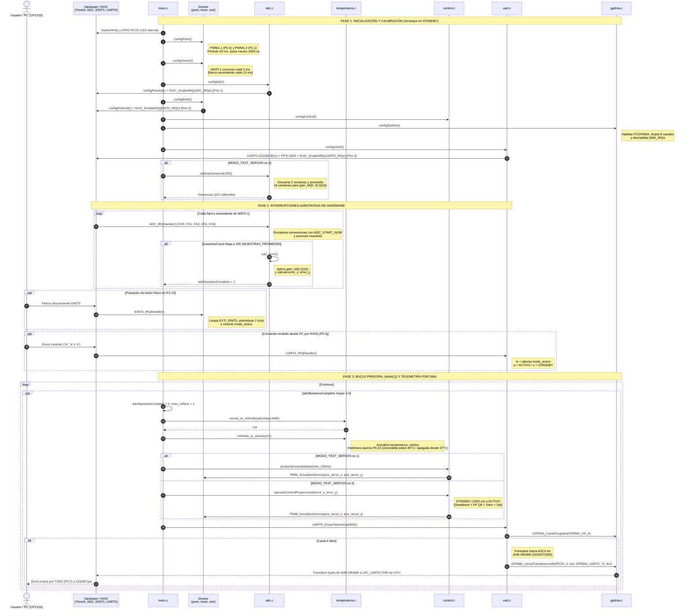

## Arquitectura y Diagrama de Secuencia

El firmware está organizado en una arquitectura modular por periférico sobre el **LPC1769 (ARM Cortex-M3)**, separando la adquisición analógica, el lazo de control en punto fijo (Q8/Q10), la protección térmica y la telemetría no bloqueante asistida por **GPDMA**.

### Jerarquía de Interrupciones (NVIC)

Para garantizar el determinismo del muestreo y de los actuadores frente a la comunicación con la PC, se establece la siguiente prioridad de interrupciones:

| Prioridad NVIC | Interrupción | Módulo | Función |
| :---: | :--- | :--- | :--- |
| **1 (Máxima)** | `ADC_IRQn` | `adc.c` | Lectura encadenada de los 5 canales analógicos (`AD0.0`–`AD0.4`). |
| **2 (Media)** | `EINT0_IRQn` | `eint.c` | Atención asíncrona del pulsador físico (`P2.10`) con antirrebote de `200 ms`. |
| **3 (Baja)** | `UART0_IRQn` | `uart.c` | Recepción de comandos desde la PC (`RXD0` en `P0.3`) sin bloquear el control. |
| **Deshabilitada** | `DMA_IRQn` | `gpdma.c` | El estado del Canal 0 se consulta por bandera hardware (`DMACEnbldChns`). |

---

### Diagrama de Secuencia del Sistema

